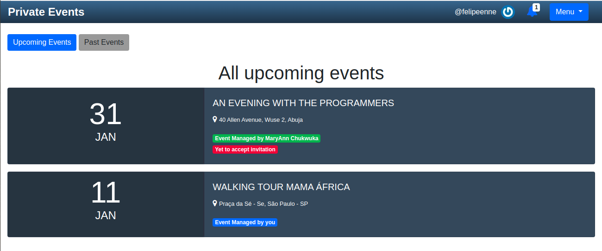

<!--
*** Thanks for checking out this README Template. 
-->


<!-- PROJECT TITLE -->

<br />
<h1 align="center">Private Events - Associations</h1>


<!-- TABLE OF CONTENTS -->


## Table of Contents

* [About this Project](#about-the-project)
  * [Built With](#built-with)
* [Required Installations](#required-installations)
* [Installation of This App](#installation-of-this-app)
* [License](#license)
* [Contact](#contact)
* [Acknowledgements](#acknowledgements)


<!-- ABOUT THE PROJECT -->
## About The Project

In this project, you will build an application named Private Events that behaves similar to Eventbrite. The main goal is to put the main concepts of Associations in Rails into practice.

Full task description: <a href="https://www.theodinproject.com/courses/ruby-on-rails/lessons/associations"> Odin Project.</a>


## Live Preview

This is the link to the live preview in Heroku - <a href="https://afternoon-waters-36349.herokuapp.com" target="_blank">Private Events</a><br>
Log in with one of the demo accounts below (username and password are the same):

* johndoe / johndoe
* janebarker / janebarker

Feel free to test or just play around with the app features. <br>

<p>Below is the Event Page Screenshot</p>
<br>


### Built With

* HTML
* CSS / SCSS
* JavaScript (esbuild)
* Bootstrap 4
* Git
* Ruby 3.3
* Ruby on Rails 7.2
* SQLite (development/test)
* PostgreSQL (production)


## Required Installations

<p>If you want a copy of this project running on your machine you have to install:</p>

* Ruby 3.3.x
* Bundler 2.5+
* Rails 7.2
* Node.js 18+ and Yarn 1.x

<a href="https://guides.rubyonrails.org/getting_started.html#creating-a-new-rails-app"> Rails installation guide</a>

<!-- INSTALATION -->
## Installation of this App

Once you have installed the required packages shown on the [Required Installations](#required-installations), proceed with the following steps.

Clone the Repository,

```Shell
git clone https://github.com/FelipeEnne/Private_Events
```

Move to the downloaded folder

```Shell
cd Private_Events
```

Install Ruby gems

```Shell
bundle install
```

Install JavaScript dependencies

```Shell
yarn install
```

Build frontend assets

```Shell
yarn build
yarn build:css
```

Prepare the database

```Shell
rails db:prepare
```

Run the app in a local server:

```Shell
bin/dev
```

Or, without Foreman:

```Shell
rails server
```

In a separate terminal, keep assets building in watch mode:

```Shell
yarn build --watch
yarn build:css --watch
```

Then, go to [http://localhost:3000](http://localhost:3000)

### Production / Heroku

For production deploys, set `RAILS_MASTER_KEY` in the environment and use Ruby + Node buildpacks. Asset compilation runs automatically via `rails assets:precompile`.

<!-- LICENSE -->
## License

Distributed under the MIT License. See `LICENSE` for more information.

<!-- CONTACT -->
## Contact
* Felipe Enne - felipeenne@gmail.com | <a href="https://github.com/FelipeEnne" target="_blank">GitHub</a> | <a href="https://www.linkedin.com/in/felipe-enne/" target="_blank">LinkedIn</a> | <a href="https://felipeenne.com/" target="_blank">Portfolio</a>
* MaryAnn Chukwuka - annychuks07@gmail.com | <a href="https://github.com/adaorachi" target="_blank">GitHub</a>

<!-- ACKNOWLEDGEMENTS -->
## Acknowledgements

* <a href="https://www.microverse.org/"> Microverse</a>  and <a href="https://www.theodinproject.com/"> Odin Project</a> .
